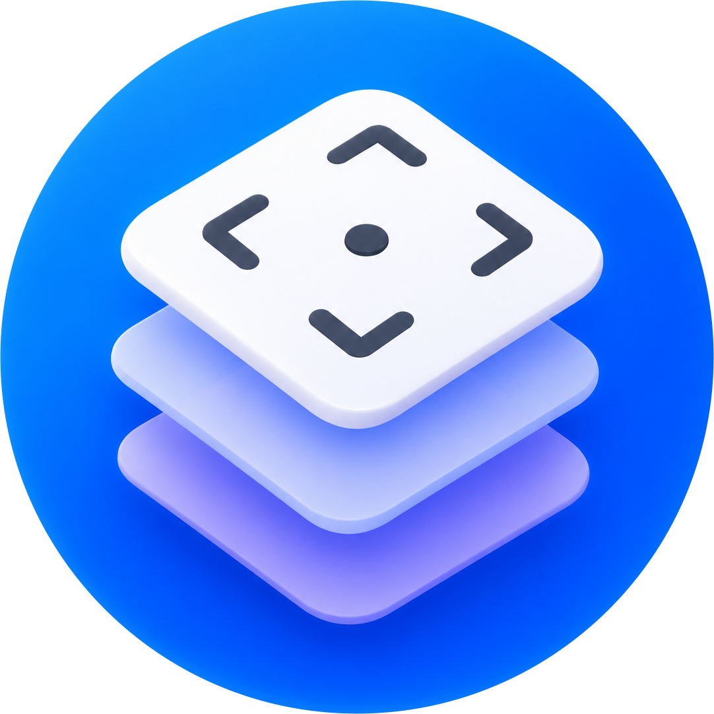
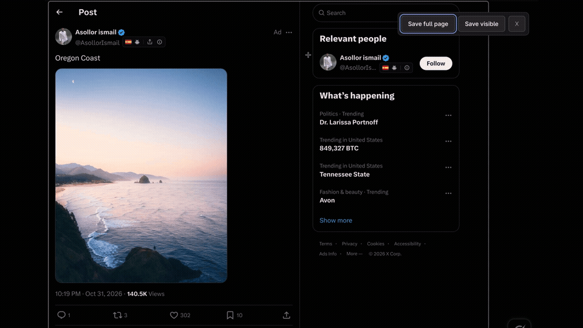

  

<h1 align="center">ElementShot</h1>

  A Chrome extension for capturing elements, selections, and full pages.

  <a href="#installation">Install</a> ·
  <a href="#take-a-screenshot">Usage</a> ·
  <a href="docs/assets/demo-video.mp4">Watch demo</a>

  

## Installation

1. [Download the extension ZIP](dist/elementshot.zip) and extract it, or use the `extension/` folder from this repository.
2. Open `chrome://extensions` in Chrome.
3. Turn on **Developer mode**.
4. Click **Load unpacked** and select the extracted folder containing `manifest.json`, or the repository’s `extension/` folder.
5. Open Chrome’s Extensions menu and pin **ElementShot**.

After updating the extension files, click **Reload** on its card in `chrome://extensions`.

## Take a screenshot

Open a website and click the **ElementShot** toolbar button.

- **Element:** hover over the page to highlight an element, then click to select it.
- **Custom area:** click and drag to draw a selection.
- **Visible page:** click **Save visible** to preview the current view.
- **Full page:** click **Save full page** to preview the whole page.

Drag a selected area to move it, or drag its edge and corner handles to resize it. Choose **Copy** to put the image on your clipboard, or **Download** to save a PNG.

In a page preview, choose **Back** to return to selection. Click **×** to cancel a selection or close the tool.

## Keyboard shortcuts

| Action | Windows / Linux | macOS |
| --- | --- | --- |
| Open ElementShot | Ctrl+Shift+Y | Command+Shift+Y |
| Cancel selection or close | Esc | Esc |

Change the activation shortcut at `chrome://extensions/shortcuts` if it conflicts with another shortcut.

## Privacy and permissions

Screenshots are processed locally in your browser. ElementShot does not upload images, collect analytics, or require an account.

Chrome asks for permissions to access the tab you activate ElementShot on, display the selection tool, and copy images to your clipboard. The extension does not request ongoing access to every website.

## Limitations

- Chrome blocks extensions on internal pages such as `chrome://settings`, the Chrome Web Store, and certain other protected pages. Open a regular website to use ElementShot.
- Keep the tab active until capture finishes. Full-page screenshots scroll through the page and restore your starting position afterward.
- Sticky headers can appear more than once in long captures. Animations and content that loads while scrolling can affect the result.
- Embedded content from another website is selected as a whole frame, rather than as individual elements inside it.
- Very large captures may exceed the image size limit. Select a smaller area if this happens.
- Clipboard copying requires a secure page that permits clipboard access. Use **Download** if copying fails.

This is an early version. Browser capture, clipboard, and download behavior have not yet been fully verified.

## Credits

The element selection flow is inspired by Zen Browser’s screenshot tool.
